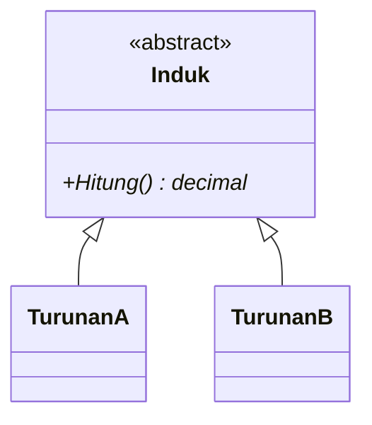

# Proyek ETS PBO

> Baca `SOAL.md` dulu. Ganti semua `TULIS_DI_SINI` di berkas ini, `AI-LOG.md`, dan `PROSES.md`. Berkas yang masih berisi
> `TULIS_DI_SINI` dianggap belum diisi.

## Identitas

- Nama: TULIS_DI_SINI
- NRP: TULIS_DI_SINI
- Domain (NRP dibagi 6, ambil sisanya): TULIS_DI_SINI

## Domain saya

Jelaskan dengan kata-kata sendiri (2-3 kalimat): siapa penggunanya dan masalah apa yang diselesaikan aplikasi ini.

TULIS_DI_SINI

## Cara menjalankan

```bash
dotnet build proyek/src
dotnet run --project proyek/src
```

## Diagram kelas

Ganti contoh ini dengan diagram kelas proyek kalian (sintaks Mermaid, tampil otomatis di GitHub).



## Status kebutuhan

Isi kolom Status dengan `selesai`, `sebagian`, atau `belum`.

| ID | Kebutuhan | Status | Catatan |
|---|---|---|---|
| K1 | Enkapsulasi | TULIS_DI_SINI | |
| K2 | Komposisi dan pewarisan | TULIS_DI_SINI | |
| K3 | Polimorfisme | TULIS_DI_SINI | |
| K4 | Abstract class dan interface | TULIS_DI_SINI | |
| K5 | Exception dan life cycle | TULIS_DI_SINI | |
| K6 | Aplikasi berjalan | TULIS_DI_SINI | |
| Khas | Aturan khas domain | TULIS_DI_SINI | |
| Bonus | Bonus yang dikerjakan | TULIS_DI_SINI | |

## Yang belum selesai

TULIS_DI_SINI (tulis "tidak ada" bila semuanya selesai)
